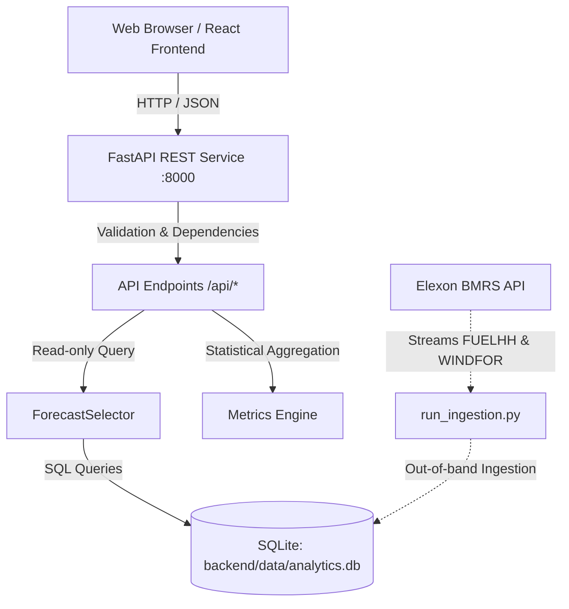

# Gridbricks UK Wind Generation Analytics REST API Guide (Stage 4)

This document provides complete instructions for configuring, running, testing, and integrating with the FastAPI REST API service layer developed in Stage 4.

---

## 1. Architecture & Design Principles

The backend REST API is built with **FastAPI** (`backend/app/`) and is backed by a local SQLite analytical database (`backend/data/analytics.db`).



### Core Tenets:
1. **Zero External API Latency on Requests:** The REST API never calls external Elexon APIs during user requests. Ingestion runs out-of-band via `run_ingestion.py` and caches data in SQLite with WAL mode and composite indices.
2. **Strict Lookahead Bias Prevention:** All metrics and timeseries use `ForecastSelector`, which deterministically enforces that any selected forecast vintage was published **on or before** the specified decision deadline (`D-1 at cutoff_time`).
3. **No Silent Zero-Filling:** Missing observations or forecast intervals are never replaced with zero. They are tracked as unmatched intervals or omitted from coverage calculations.
4. **Thin Handlers & Shared Core:** Endpoint handlers do not re-implement metric math or forecast selection SQL; they delegate to `ForecastSelector`, `calculate_metrics`, and `calculate_daily_metrics`.

---

## 2. Installation & Local Setup

### Prerequisites
- Python 3.10+ (tested on Python 3.14 on macOS)
- `pip` and `venv`

### Step 1: Set up Virtual Environment & Install Dependencies
```bash
# Navigate to the workspace root
cd ~/Developer/gridbricks-challenge

# Create and activate virtual environment
python3 -m venv .venv
source .venv/bin/activate

# Install backend dependencies
pip install -r backend/requirements.txt
```

### Step 2: Environment Configuration
The service is preconfigured with safe local defaults in `backend/app/config.py`:
- `PORT`: Server port (default: `8000`)
- `DATABASE_PATH`: SQLite database path (default: `backend/data/analytics.db`)
- `CORS_ORIGINS`: Comma-separated list of allowed origins (default: `http://localhost:5173,http://localhost:3000,http://127.0.0.1:5173,http://127.0.0.1:3000`)

To override any setting, set environment variables prior to running the server:
```bash
export CORS_ORIGINS="http://localhost:5173,http://localhost:8080"
export PORT=8000
```

### Step 3: Run the Ingestion Pipeline (If Database Is Not Pre-Seeded)
The repository includes a pre-seeded `backend/data/analytics.db` containing 1,488 January 2026 actuals and 19,272 forecast records. If re-seeding from scratch:
```bash
python3 run_ingestion.py
```

### Step 4: Start the API Service
```bash
uvicorn backend.app.main:app --host 0.0.0.0 --port 8000 --reload
```
- **Base URL:** `http://localhost:8000/api`
- **Interactive Swagger UI:** `http://localhost:8000/docs`
- **ReDoc Documentation:** `http://localhost:8000/redoc`
- **OpenAPI JSON Spec:** `http://localhost:8000/openapi.json`

---

## 3. Analytical Assumptions & Methodology

### 3.1 The D-1 11:00 UTC Baseline Cutoff
* **Rationale:** Modeled on the day-ahead auction order-book closure convention in the Great Britain electricity market (e.g., EPEX SPOT and Nord Pool 11:00 GMT/UTC day-ahead auctions).
* **Classification:** **Analytical assumption** (not an official Elexon rule). Energy procurement teams submit bids before 11:00; therefore, wind forecasts published after 11:00 on Day D-1 are strictly inadmissible for day-ahead position setting.
* **Configurability:** The API allows testing alternative cutoffs (e.g. `09:00`, `12:00`, `16:00`) via the `cutoff_time` parameter.

### 3.2 Error Sign Convention
All errors are calculated strictly as:
$$\text{Error}_i = \text{Forecast}_i - \text{Actual}_i$$
* **$\text{Error} > 0$:** Over-forecasting (forecast exceeded actual generation).
* **$\text{Error} < 0$:** Under-forecasting (actual generation exceeded forecast).

### 3.3 Statistical Metric Definitions
* **Mean Absolute Error (MAE):**
  $$\text{MAE} = \frac{1}{N} \sum_{i=1}^N |\text{Forecast}_i - \text{Actual}_i|$$
* **Root Mean Squared Error (RMSE):**
  $$\text{RMSE} = \sqrt{\frac{1}{N} \sum_{i=1}^N (\text{Forecast}_i - \text{Actual}_i)^2}$$
* **Mean Bias Error (MBE):**
  $$\text{MBE} = \frac{1}{N} \sum_{i=1}^N (\text{Forecast}_i - \text{Actual}_i)$$
* **Normalized MAE Percentage:**
  $$\text{Normalized MAE \%} = \frac{\text{MAE}}{\overline{\text{Actual}}} \times 100$$
  *(Where $\overline{\text{Actual}} = \frac{1}{N} \sum \text{Actual}_i$. Returns null if mean actual is zero).*

### 3.4 Evaluation Resolutions: Native vs. Hourly Aggregated
* **`native_half_hour` (Default & Primary):**
  * Elexon FUELHH actuals arrive every 30 minutes (48 settlement periods per day; 1,488 in January).
  * WINDFOR forecasts are published on the hour (`:00`).
  * In native mode, both settlement periods within an hour (e.g. 12:00–12:30 SP 25 and 12:30–13:00 SP 26) are paired against the prevailing hourly forecast.
  * Preserves intraday volatility and true market settlement resolution.
* **`hourly_aggregated`:**
  * Aggregates the two half-hour actuals within each hour to an arithmetic mean ($\overline{A}_{hour} = \frac{A_{:00} + A_{:30}}{2}$).
  * Paired with the hourly forecast (744 total intervals in January).

---

## 4. Endpoints Reference

### 4.1 Health Check
`GET /api/health`

Verifies that the API service is operational, checks live database connectivity, and confirms whether the January 2026 dataset is populated.

**Query Parameters:** None

**Response Code:** `200 OK` (Healthy) or `503 Service Unavailable` (Unhealthy)

**Example Request:**
```bash
curl -s http://localhost:8000/api/health
```

**Example Response (`200 OK`):**
```json
{
  "status": "healthy",
  "database": "connected",
  "dataset_available": true,
  "dataset_period": "2026-01-01 to 2026-01-31"
}
```

---

### 4.2 Dataset Summary
`GET /api/summary`

Returns key statistical facts computed dynamically from SQLite, including record counts, distinct forecast vintages, delivery timestamp bounds, invalid record audits, and configured baseline cutoff metadata.

**Query Parameters:** None

**Example Request:**
```bash
curl -s http://localhost:8000/api/summary
```

**Example Response (`200 OK`):**
```json
{
  "evaluation_period": {
    "start_date": "2026-01-01",
    "end_date": "2026-01-31"
  },
  "actual_observation_count": 1488,
  "forecast_observation_count": 19272,
  "distinct_forecast_publication_timestamps": 264,
  "first_delivery_timestamp": "2026-01-01T00:00:00Z",
  "last_delivery_timestamp": "2026-01-31T23:30:00Z",
  "missing_or_invalid_actual_count": 0,
  "missing_or_invalid_forecast_count": 0,
  "baseline_decision_cutoff": "11:00",
  "cutoff_assumption_status": "Analytical assumption (modeled on GB Day-Ahead auction conventions; not an official Elexon rule)"
}
```

---

### 4.3 Forecast Accuracy Metrics
`GET /api/metrics`

Calculates MAE, RMSE, MBE, coverage percentage, mean actual, and mean forecast for the specified date range, resolution, and D-1 cutoff time.

**Query Parameters:**
| Parameter | Type | Required | Default | Description |
|---|---|---|---|---|
| `start_date` | string | No | `2026-01-01` | Start date in `YYYY-MM-DD` format |
| `end_date` | string | No | `2026-01-31` | End date in `YYYY-MM-DD` format |
| `resolution` | string | No | `native_half_hour` | `native_half_hour` (or `half_hour`) vs `hourly_aggregated` (or `hourly`) |
| `cutoff_time` | string | No | `11:00` | Decision deadline time in UTC (`HH:MM`) on Day D-1 |

**Example Request:**
```bash
curl -s "http://localhost:8000/api/metrics?start_date=2026-01-01&end_date=2026-01-31&cutoff_time=11:00&resolution=native_half_hour"
```

**Example Response (`200 OK`):**
```json
{
  "cutoff_time": "11:00",
  "alignment_mode": "native_half_hour",
  "start_date": "2026-01-01",
  "end_date": "2026-01-31",
  "mae": 2126.12,
  "rmse": 2620.8,
  "mbe": 1840.3,
  "normalized_mae_percentage": 18.36,
  "mean_actual": 11580.74,
  "mean_forecast": 13421.03,
  "total_expected_intervals": 1488,
  "available_actuals": 1488,
  "available_forecasts": 1488,
  "matched_intervals": 1488,
  "coverage_percentage": 100.0,
  "error_convention": "forecast - actual",
  "cutoff_assumption": "Analytical assumption (modeled on GB Day-Ahead auction conventions; not an official Elexon rule)"
}
```

---

### 4.4 Time-Series Data
`GET /api/timeseries`

Returns chronological paired observations of actual generation and selected day-ahead forecasts suitable for rendering time-series charts on the frontend.

**Query Parameters:**
| Parameter | Type | Required | Default | Description |
|---|---|---|---|---|
| `start_date` | string | No | `2026-01-01` | Start date in `YYYY-MM-DD` format |
| `end_date` | string | No | `2026-01-31` | End date in `YYYY-MM-DD` format |
| `resolution` | string | No | `native_half_hour` | `native_half_hour` vs `hourly_aggregated` |
| `cutoff_time` | string | No | `11:00` | Cutoff time in UTC (`HH:MM`) on Day D-1 |

**Example Request (First Day):**
```bash
curl -s "http://localhost:8000/api/timeseries?start_date=2026-01-01&end_date=2026-01-01"
```

**Example Response Structure:**
```json
{
  "resolution": "native_half_hour",
  "cutoff_time": "11:00",
  "start_date": "2026-01-01",
  "end_date": "2026-01-01",
  "count": 48,
  "data": [
    {
      "start_time": "2026-01-01T00:00:00Z",
      "settlement_period": 1,
      "actual_generation": 13756.0,
      "forecast_generation": 19466.0,
      "error": 5710.0,
      "forecast_publish_time": "2025-12-31T09:30:00Z",
      "is_matched": true
    },
    {
      "start_time": "2026-01-01T00:30:00Z",
      "settlement_period": 2,
      "actual_generation": 13873.0,
      "forecast_generation": 19466.0,
      "error": 5593.0,
      "forecast_publish_time": "2025-12-31T09:30:00Z",
      "is_matched": true
    }
  ]
}
```

---

### 4.5 Daily Breakdown
`GET /api/daily-metrics`

Returns a chronological daily accuracy breakdown for the selected evaluation period, reporting day-level MAE, RMSE, MBE, and an `is_complete` boolean flag (distinguishing complete days with 48 intervals from partial days).

**Query Parameters:**
| Parameter | Type | Required | Default | Description |
|---|---|---|---|---|
| `start_date` | string | No | `2026-01-01` | Start date in `YYYY-MM-DD` format |
| `end_date` | string | No | `2026-01-31` | End date in `YYYY-MM-DD` format |
| `resolution` | string | No | `native_half_hour` | `native_half_hour` vs `hourly_aggregated` |
| `cutoff_time` | string | No | `11:00` | Cutoff time in UTC (`HH:MM`) on Day D-1 |

**Example Request:**
```bash
curl -s "http://localhost:8000/api/daily-metrics?start_date=2026-01-01&end_date=2026-01-03"
```

**Example Response:**
```json
{
  "cutoff_time": "11:00",
  "resolution": "native_half_hour",
  "start_date": "2026-01-01",
  "end_date": "2026-01-03",
  "days_count": 3,
  "days": [
    {
      "date": "2026-01-01",
      "total_intervals": 48,
      "matched_intervals": 48,
      "is_complete": true,
      "mae": 4258.21,
      "rmse": 4301.67,
      "mbe": 4258.21,
      "mean_actual": 15371.96,
      "mean_forecast": 19630.17
    },
    {
      "date": "2026-01-02",
      "total_intervals": 48,
      "matched_intervals": 48,
      "is_complete": true,
      "mae": 3196.21,
      "rmse": 3249.7,
      "mbe": 3196.21,
      "mean_actual": 15169.08,
      "mean_forecast": 18365.29
    },
    {
      "date": "2026-01-03",
      "total_intervals": 48,
      "matched_intervals": 48,
      "is_complete": true,
      "mae": 1916.15,
      "rmse": 2341.35,
      "mbe": 1902.94,
      "mean_actual": 14073.48,
      "mean_forecast": 15976.42
    }
  ]
}
```

---

### 4.6 Forecast Revision History (Evolution)
`GET /api/forecast-evolution`

Demonstrates the value of preserving historical publication vintages by returning all forecast revisions published for a specific target delivery hour in chronological order from earliest to latest.

**Query Parameters:**
| Parameter | Type | Required | Description |
|---|---|---|---|
| `start_time` | string | **Yes** | ISO 8601 UTC target delivery timestamp (e.g. `2026-01-15T12:00:00Z`) |

**Example Request:**
```bash
curl -s "http://localhost:8000/api/forecast-evolution?start_time=2026-01-15T12:00:00Z"
```

**Example Response:**
```json
{
  "target_start_time": "2026-01-15T12:00:00Z",
  "revisions_count": 24,
  "revisions": [
    {
      "publish_time": "2026-01-13T02:30:00Z",
      "start_time": "2026-01-15T12:00:00Z",
      "generation": 11938
    },
    {
      "publish_time": "2026-01-13T04:30:00Z",
      "start_time": "2026-01-15T12:00:00Z",
      "generation": 11888
    },
    {
      "publish_time": "2026-01-13T07:30:00Z",
      "start_time": "2026-01-15T12:00:00Z",
      "generation": 11562
    },
    {
      "publish_time": "2026-01-15T11:30:00Z",
      "start_time": "2026-01-15T12:00:00Z",
      "generation": 12845
    }
  ]
}
```

---

## 5. Input Validation & Error Handling

All endpoints validate query parameters before execution:
* **Invalid Date Format:** e.g., `start_date=2026-13-45` $\rightarrow$ `HTTP 400 Bad Request`
  ```json
  {"detail": "Invalid start_date format: '2026-13-45'. Expected YYYY-MM-DD."}
  ```
* **Reversed Date Range:** e.g., `start_date=2026-01-10&end_date=2026-01-05` $\rightarrow$ `HTTP 400 Bad Request`
  ```json
  {"detail": "Invalid date range: start_date '2026-01-10' must be before or equal to end_date '2026-01-05'."}
  ```
* **Unsupported Resolution:** e.g., `resolution=10m` $\rightarrow$ `HTTP 400 Bad Request`
  ```json
  {"detail": "Unsupported resolution: '10m'. Supported values are 'native_half_hour' (or 'half_hour') and 'hourly_aggregated' (or 'hourly')."}
  ```
* **Invalid Cutoff Time:** e.g., `cutoff_time=25:00` $\rightarrow$ `HTTP 400 Bad Request`
  ```json
  {"detail": "Invalid cutoff_time values in '25:00'. Hours must be 0-23 and minutes 0-59."}
  ```
* **Missing Required Parameter:** e.g. `GET /api/forecast-evolution` without `start_time` $\rightarrow$ `HTTP 422 Unprocessable Entity`
* **Database Connection Failure:** e.g., disconnected SQLite $\rightarrow$ `HTTP 503 Service Unavailable` with sanitized body:
  ```json
  {
    "status": "unhealthy",
    "database": "disconnected",
    "dataset_available": false,
    "dataset_period": null
  }
  ```

---

## 6. Automated Testing

The automated test suite contains **32 tests** (18 ingestion and analytical tests + 14 dedicated API endpoint tests) using isolated, temporary SQLite test databases and FastAPI's `TestClient`.

### Running All Tests
```bash
source .venv/bin/activate
PYTHONPATH=. pytest -v
```

### Test Coverage Highlights
1. `test_health_check_success_and_dataset_availability`: Validates healthy 200 responses and dataset availability.
2. `test_health_check_database_failure`: Verifies HTTP 503 and safe disconnection status without stack trace leaks.
3. `test_summary_counts_derived_from_test_data`: Checks dynamic computation of observation counts and metadata.
4. `test_metrics_native_half_hour_resolution`: Validates mathematical correctness of MAE, RMSE, MBE, and coverage against an independently solved 4-interval fixture.
5. `test_metrics_hourly_aggregated_mode`: Verifies hourly aggregation arithmetic and resulting metrics.
6. `test_metrics_cutoff_excludes_post_deadline_forecasts`: Proves zero lookahead bias when shifting cutoff time from 11:00 to 16:00.
7. `test_month_boundary_dates`: Verifies that Jan 1 delivery correctly selects Dec 31 day-ahead forecasts across the month boundary.
8. `test_invalid_dates_return_400`: Verifies HTTP 400 rejection for malformed dates and reversed ranges.
9. `test_invalid_resolution_returns_400`: Verifies HTTP 400 rejection for invalid resolutions.
10. `test_invalid_cutoff_time_returns_400`: Verifies HTTP 400 rejection for invalid cutoff times.
11. `test_empty_dataset_safe_response`: Verifies that querying an empty range returns null metrics without division-by-zero crashes.
12. `test_timeseries_chronological_ordering`: Ensures chronological order, settlement period numbering, and error sign.
13. `test_daily_metrics_identifies_incomplete_coverage`: Verifies daily breakdown flags incomplete days (`is_complete=False`).
14. `test_forecast_evolution_chronological_revisions`: Verifies revisions are returned in publication order.
15. Tests 15–32: Verify client retry policies, 429 rate limit backoff, deduplication, resolution preservation, and strict null handling.
