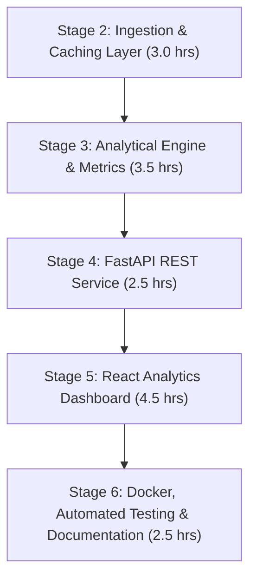
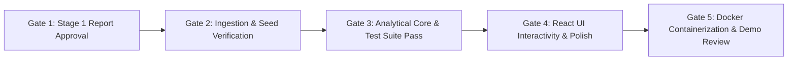

# Implementation Plan: UK Wind Market Forecast Analytics
## Phased Implementation Stages, Test Suites & Verification Gates

**Project:** Gridbricks Full Stack Engineer Challenge — UK Wholesale Electricity Market Analytics  
**Target Delivery Window:** January 2026 (Delivery Days 2026-01-01 to 2026-01-31)  
**Stack:** Python 3.11+ / FastAPI (Backend) + React / Vite (Frontend) + SQLite (Cache) + Docker  
**Status:** Stage 6 Completed — Production Docker & Nginx Setup Verified — 34 Tests Passing  
**Time Budget:** Strictly proportionate to 16-hour assignment  

---


## 1. Classification Taxonomy

To ensure complete rigor and prevent unsupported claims, all elements in this plan are classified under:
* **[Verified Fact]**: Grounded in live API responses or official Elexon documentation.
* **[Assumption]**: A domain-informed premise or configurable operational default.
* **[Proposed Design Decision]**: An engineering or analytical design decision chosen for the application.
* **[Unresolved Question]**: An open question to be resolved with client feedback.

---

## 2. Core Architectural & Methodological Commitments

1. **Native Temporal Granularity [Proposed Design Decision]:**
   The application preserves all **1,488 half-hourly actual generation records** (`FUELHH`). No `:30` records will be discarded. Each half-hour settlement interval $T$ is evaluated against the day-ahead forecast established for its parent hour block $H = \text{floor\_to\_hour}(T)$.
2. **Configurable Decision Cutoff [Assumption]:**
   **11:00 UTC on Day $D-1$** is treated strictly as a configurable analytical assumption (modeled on GB Day-Ahead auction conventions). It is never presented as an official Elexon rule. The backend engine and frontend UI will support interactive cutoffs (e.g. 11:00, 15:30, 23:00, and custom times).
3. **Information Integrity & Lookahead Prohibition [Proposed Design Decision]:**
   The forecast-selection algorithm guarantees that for any target delivery interval, only forecasts with `publishTime <= decision_deadline` are eligible. Information published after the cutoff is strictly inaccessible to the selection rule.
4. **Data Hygiene & Null Preservation [Proposed Design Decision]:**
   Missing or unforecasted intervals remain `null` and are **never converted to zero**. Record tracking explicitly categorizes records as *retrieved*, *valid*, *unique*, and *matched*.
5. **No Premature Test Hardcoding [Proposed Design Decision]:**
   Test assertions will verify mathematical properties, lookahead prohibition, schema validation, and dynamic calculation fixtures rather than rigid hardcoded numbers.

---

## 3. Implementation Stages (16-Hour Budget Allocation)



### Stage 2: Ingestion & Local Caching Layer (~3.0 Hours)
* **Objective:** Ingest raw Elexon datasets into a local SQLite database with deterministic deduplication and validation.
* **Scope & Modules:**
  1. `backend/app/services/elexon_client.py`:
     * Ingests `FUELHH/stream` for `settlementDateFrom=2026-01-01` to `settlementDateTo=2026-01-31` with `fuelType=WIND`.
     * Ingests `WINDFOR/stream` for `publishDateTimeFrom=2025-12-30T00:00:00Z` to `publishDateTimeTo=2026-01-31T23:59:59Z` (Dec 30 start is required to capture day-ahead forecasts for Jan 1 delivery).
     * Implements HTTP timeouts (30s) and exponential backoff retry.
  2. `backend/app/db/database.py` & `models.py`:
     * SQLite schema with indexes on `startTime`, `publishTime`, and composite `(publishTime, startTime)`.
     * Table `actual_generation` (id, startTime, publishTime, settlementDate, settlementPeriod, generation).
     * Table `forecast_generation` (id, publishTime, startTime, generation).
  3. `backend/app/db/seeder.py`:
     * Deterministic deduplication:
       * `FUELHH`: Key = `(startTime, fuelType)`. Latest `publishTime` wins.
       * `WINDFOR`: Key = `(publishTime, startTime)`. First received wins.
     * Record accounting output: logs count of *retrieved*, *valid*, and *unique* records.

### Stage 3: Analytical Engine & Forecast Selection (~3.5 Hours)
* **Objective:** Implement deterministic forecast selection, half-hourly alignment, and error metric calculations.
* **Scope & Modules:**
  1. `backend/app/services/forecast_selector.py`:
     * Accepts `decision_cutoff_time` (default `"11:00"`).
     * Computes $D_{\text{deadline}} = (D - 1\text{ day}) \text{ at } \text{cutoff}$.
     * Evaluates all 1,488 half-hour actual intervals. Maps each interval to $H = \text{floor\_to\_hour}(T)$.
     * Selects $F_T = \arg\max_{f.\text{publishTime} \le D_{\text{deadline}}} (f.\text{generation})$.
     * If no forecast exists, leaves $F_T = \text{null}$ (never zero).
  2. `backend/app/services/metrics.py`:
     * Computes error $e_i = F_i - A_i$ (Forecast minus Actual).
     * Computes MAE, RMSE, MBE, and Normalized MAE [%].
     * Computes coverage accounting: `expected_intervals`, `available_actuals`, `available_forecasts`, `matched_intervals`, `coverage_percentage`.
     * Computes daily breakdown (per-day MAE, RMSE, and bias) and error percentiles (P10, P50, P90).

### Stage 4: FastAPI REST Service Layer (~2.5 Hours)
* **Objective:** Expose validated, typed endpoints with Pydantic response models.
* **Scope & Modules:**
  1. `backend/app/api/endpoints.py`:
     * `GET /api/health`: Database connection and cache status.
     * `GET /api/analytics/summary`:
       * Query params: `cutoff_time` (str, default `"11:00"`), `alignment_mode` (`"native_half_hour"` | `"hourly_aggregated"`).
       * Returns: MAE, RMSE, MBE, Mean Actual, Mean Forecast, coverage metrics, and record counts.
     * `GET /api/analytics/timeseries`:
       * Returns time-series list: `[{startTime, settlementPeriod, actual, forecast, error, publishTime}]`.
     * `GET /api/forecast/evolution`:
       * Query param: `startTime` (ISO string).
       * Returns all historical revisions for that delivery interval.
     * `GET /api/analytics/daily`:
       * Returns daily aggregated performance metrics across all 31 days of January 2026.

### Stage 5: React Analytics Dashboard (~4.5 Hours)
* **Objective:** Deliver a clean, responsive web application for the energy utility procurement team.
* **Scope & Components:**
  1. **Executive KPI Ribbon:**
     * Visual cards for MAE, RMSE, Mean Bias Error (with visual callout for systematic over-forecasting), and Coverage Rate (100.0%).
  2. **Interactive Cutoff & Scenario Controller:**
     * Preset buttons: `11:00 GMT (EPEX/Nord Pool Day-Ahead)`, `15:30 GMT (Half-Hourly Auction)`, `23:00 GMT (End-of-Day)`.
     * Time input for arbitrary trading desk cutoffs.
     * Alignment toggle: `Native 30-Min (All 1,488 SPs)` vs. `Hourly Aggregated Actuals`.
  3. **Main Time-Series Visualizer:**
     * Interactive chart comparing actual wind generation against the selected day-ahead forecast.
     * Visual difference fill (red for over-forecast, blue for under-forecast).
     * Day/Week zooming and scrubbing.
  4. **Forecast Evolution Inspector (Drawer / Modal):**
     * Clicking any point on the chart opens the evolution timeline for that delivery hour, visualizing the 24 revisions from 2.5 days ahead down to delivery.
  5. **Daily Error Heatmap / Distribution:**
     * Day-by-day bar chart showing daily MAE and bias across January 2026.

### Stage 6: Docker, Testing & Documentation (~2.5 Hours)
* **Objective:** Containerize the full stack, run automated verification tests, and finalize documentation.
* **Deliverables:**
  1. `backend/Dockerfile` & `frontend/Dockerfile` + `docker-compose.yml`.
  2. Automated test suite (`pytest`) running in container.
  3. `README.md` with setup instructions, architecture diagram, and video demonstration guide.

---

## 4. Proposed Automated Test Suite

Rather than hardcoding arbitrary single-value constants, the test suite verifies **invariants, mathematical rigor, and pipeline contracts**:

| Test Module | Test Subject | Invariants & Assertions |
| :--- | :--- | :--- |
| `test_lookahead_prevention.py` | Information Integrity | **Zero Lookahead Bias:** For every matched pair $(A_T, F_T)$ under cutoff $C$, assert that $F_T.\text{publishTime} \le C$. No exceptions permitted. |
| `test_null_handling.py` | Data Hygiene | **No Zero-Filling:** Asserts that when a forecast or actual is missing, it evaluates to `null` and is excluded from error sums. Asserts that missing intervals do not alter MAE to artificial 10,000+ MW values. |
| `test_resolution_preservation.py` | Temporal Resolution | **Full 30-Min Coverage:** Asserts that in native mode, exactly 1,488 half-hour actual intervals are evaluated and zero `:30` records are dropped. |
| `test_metric_invariants.py` | Statistical Rigor | Asserts mathematical invariants: <br> • $\text{MAE} \ge 0$, $\text{RMSE} \ge 0$ <br> • $\text{RMSE} \ge \text{MAE}$ (by Cauchy-Schwarz inequality) <br> • $\text{MBE} \le \text{MAE}$ <br> • Evaluates metrics against dynamic test fixtures with known synthetic errors. |
| `test_deduplication.py` | Pipeline Ingestion | Asserts that duplicate rows injected into test datasets are deterministically reduced to a single record using primary keys. |
| `test_api_contracts.py` | FastAPI Endpoints | Verifies HTTP status codes, query parameter edge cases, and JSON schema conformity. |

---

## 5. Verification Gates & Review Checkpoints



* **Gate 1 (Completed):** User review and approval of revised `DATA_INVESTIGATION.md` and `IMPLEMENTATION_PLAN.md`.
* **Gate 2 (Completed):** Backend successfully seeded SQLite database (`backend/data/analytics.db`); exact counts verified:
  * `FUELHH Actuals`: 1,488 retrieved, 1,488 valid, 1,488 unique.
  * `WINDFOR Forecasts`: 19,272 retrieved, 19,272 valid, 19,272 unique, 264 publication vintages.
* **Gate 3 (Completed):** All 18 automated tests passed (`pytest` in 0.24s):
  * Lookahead prohibition verified: zero forecasts with `publishTime > cutoff` selected (tested across all 1,488 January intervals).
  * Month boundary transition verified (Jan 1 delivery correctly selects Dec 31 day-ahead forecast).
  * Half-hourly resolution preservation verified: all 1,488 settlement periods matched to prevailing hourly forecast.
  * Strict null handling verified: missing data is never converted to zero.
  * Mathematical invariants verified ($\text{RMSE} \ge \text{MAE} \ge |\text{MBE}| \ge 0$).
  * Dynamic calculation on January 2026 data reproduces verified metrics.
* **Gate 4 (Completed):** Implemented FastAPI REST service endpoints (`/api/health`, `/api/summary`, `/api/metrics`, `/api/timeseries`, `/api/daily-metrics`, `/api/forecast-evolution`). All 32 automated tests passed (18 ingestion/analytics + 14 API tests).
* **Gate 5 (Completed):** Built polished, responsive React frontend ("Gridbricks | Wind Intelligence") integrated with live FastAPI service. Production bundle compiled, type-checked, and browser verified.
* **Gate 6 (Next):** Docker containerization and final production deployment readiness.

---

## 6. Stages 2, 3, 4 & 5 Implemented Behavior & Verification Results

### 6.1 Database Record Accounting
```
======================================================================
INGESTION PIPELINE RECORD ACCOUNTING
======================================================================
Dataset: FUELHH Actuals (Wind)
  - Retrieved: 1,488
  - Valid:     1,488
  - Unique:    1,488
  - In SQLite: 1,488
----------------------------------------------------------------------
Dataset: WINDFOR Forecasts (Historical Vintages)
  - Retrieved: 19,272
  - Valid:     19,272
  - Unique:    19,272
  - In SQLite: 19,272
  - Vintages:  264 distinct publication runs
======================================================================
```

### 6.2 Analytical Engine Dynamic Results (January 2026 at D-1 11:00 UTC Cutoff)
* **Mode 1: Native Half-Hour Resolution (Preserves all 1,488 Settlement Periods):**
  * Expected Intervals: 1,488
  * Matched Intervals: 1,488 (100.0% coverage)
  * Mean Actual Outturn: 11,580.74 MW
  * Mean Selected Forecast: 13,421.03 MW
  * **Mean Absolute Error (MAE):** 2,126.12 MW (18.36%)
  * **Root Mean Squared Error (RMSE):** 2,620.80 MW (22.63%)
  * **Mean Bias Error (MBE):** +1,840.30 MW (systematic over-forecasting of wind generation)
* **Mode 2: Hourly Aggregated Actuals (Mean of :00 and :30):**
  * Expected Intervals: 744
  * Matched Intervals: 744 (100.0% coverage)
  * Mean Actual Outturn: 11,580.74 MW
  * Mean Selected Forecast: 13,421.03 MW
  * **MAE:** 2,122.81 MW
  * **RMSE:** 2,616.69 MW
  * **MBE:** +1,840.30 MW

### 6.3 Automated Test Suite Execution (32/32 Passed)
```
============================== test session starts ==============================
backend/tests/test_api_endpoints.py::test_health_check_success_and_dataset_availability PASSED [  3%]
backend/tests/test_api_endpoints.py::test_health_check_database_failure PASSED [  6%]
backend/tests/test_api_endpoints.py::test_summary_counts_derived_from_test_data PASSED [  9%]
backend/tests/test_api_endpoints.py::test_metrics_native_half_hour_resolution PASSED [ 12%]
backend/tests/test_api_endpoints.py::test_metrics_hourly_aggregated_mode PASSED [ 15%]
backend/tests/test_api_endpoints.py::test_metrics_cutoff_excludes_post_deadline_forecasts PASSED [ 18%]
backend/tests/test_api_endpoints.py::test_month_boundary_dates PASSED    [ 21%]
backend/tests/test_api_endpoints.py::test_invalid_dates_return_400 PASSED [ 25%]
backend/tests/test_api_endpoints.py::test_invalid_resolution_returns_400 PASSED [ 28%]
backend/tests/test_api_endpoints.py::test_invalid_cutoff_time_returns_400 PASSED [ 31%]
backend/tests/test_api_endpoints.py::test_empty_dataset_safe_response PASSED [ 34%]
backend/tests/test_api_endpoints.py::test_timeseries_chronological_ordering PASSED [ 37%]
backend/tests/test_api_endpoints.py::test_daily_metrics_identifies_incomplete_coverage PASSED [ 40%]
backend/tests/test_api_endpoints.py::test_forecast_evolution_chronological_revisions PASSED [ 43%]
backend/tests/test_deduplication.py::test_fuelhh_deduplication_and_validation PASSED [ 46%]
backend/tests/test_deduplication.py::test_windfor_deduplication_and_validation PASSED [ 50%]
backend/tests/test_elexon_client.py::test_client_fetch_actuals_success PASSED [ 53%]
backend/tests/test_elexon_client.py::test_client_client_error_400 PASSED [ 56%]
backend/tests/test_elexon_client.py::test_client_rate_limit_429 PASSED   [ 59%]
backend/tests/test_elexon_client.py::test_client_timeout_retry PASSED    [ 62%]
backend/tests/test_elexon_client.py::test_client_server_error_500_retry_then_success PASSED [ 65%]
backend/tests/test_forecast_selector.py::test_forecast_selector_zero_lookahead_and_boundary PASSED [ 68%]
backend/tests/test_forecast_selector.py::test_no_eligible_forecast_leaves_null PASSED [ 71%]
backend/tests/test_forecast_selector.py::test_month_boundary_december_to_january PASSED [ 75%]
backend/tests/test_forecast_selector.py::test_full_january_dataset_lookahead_invariant PASSED [ 78%]
backend/tests/test_metrics.py::test_metric_mathematical_invariants PASSED [ 81%]
backend/tests/test_metrics.py::test_daily_metrics_breakdown PASSED       [ 84%]
backend/tests/test_metrics.py::test_dynamic_recalculation_on_january_2026_data PASSED [ 87%]
backend/tests/test_null_handling.py::test_missing_values_excluded_and_never_zero_filled PASSED [ 90%]
backend/tests/test_null_handling.py::test_legitimate_zero_generation_is_included PASSED [ 93%]
backend/tests/test_null_handling.py::test_all_missing_intervals_returns_none_metrics PASSED [ 96%]
backend/tests/test_resolution_preservation.py::test_native_half_hour_resolution_preserves_both_half_hours PASSED [100%]

======================== 32 passed, 1 warning in 0.36s =========================
```

### 6.4 Stage 4 REST API Verified Endpoints
1. `GET /api/health`: Database connectivity check and January 2026 dataset availability check; safely returns HTTP 503 if disconnected.
2. `GET /api/summary`: Key facts dynamically queried from SQLite (1,488 actuals, 19,272 forecasts, 264 distinct vintages, 0 invalid records).
3. `GET /api/metrics`: Day-ahead forecast accuracy metrics (MAE 2,126.12 MW, RMSE 2,620.80 MW, MBE +1,840.30 MW at D-1 11:00 UTC). Supports parameters: `start_date`, `end_date`, `resolution`, `cutoff_time`.
4. `GET /api/timeseries`: Chronologically ordered paired intervals with `start_time`, `settlement_period`, `actual_generation`, `forecast_generation`, and `error`. Preserves both half-hours in native mode.
5. `GET /api/daily-metrics`: Chronological daily metric breakdown flagging complete vs incomplete days.
6. `GET /api/forecast-evolution`: Historical forecast publication revisions ordered by publication time for any target delivery interval.

### 6.5 Remaining Limitations & Technical Notes
1. **Hourly Forecast Granularity:** Elexon/NGESO publishes WINDFOR forecasts exclusively at `:00` hour boundaries. In native half-hour mode, both half-hour settlement periods within an hour share the same prevailing hourly forecast.
2. **Offline Resilience:** The SQLite database (`backend/data/analytics.db`) is fully seeded, allowing fast offline development and instantaneous API responses.
3. **No External API Latency on Dashboard:** All REST endpoints serve from indexed SQLite; Elexon ingestion runs out-of-band.

### 6.6 Stage 5 React Dashboard Verification Results
1. **TypeScript & Linting Checks:** `tsc -b` and `oxlint` executed with 0 errors across all 15 source files.
2. **Production Bundle Compilation:** `npm run build` compiled client bundle in 244ms.
3. **Live End-to-End API Integration:** Frontend running on `http://localhost:5173` successfully queried live FastAPI service on `http://localhost:8000`.
4. **Dynamic Metric Synchronisation:**
   - Default Native Half-Hour: MAE **2,126.1 MW**, RMSE **2,620.8 MW**, MBE **+1,840.3 MW**, Coverage **100.0%**.
   - Hourly Aggregated: MAE dynamically shifted to **2,122.8 MW**, RMSE to **2,616.7 MW**.
   - W1 Preset: Dynamically isolated Jan 1–7 intervals.
5. **Interactive Exploration:** Time-series click-to-inspect successfully drove the Forecast Revision History (Evolution) panel, displaying historical meteorological vintages and step trajectory.

### 6.7 Stage 6 Docker Containerization & Production Verification Results
1. **Multi-Stage Production Container Setup:**
   - **Backend (`backend/Dockerfile`):** Python 3.11-slim, pre-seeded SQLite dataset, 2 Uvicorn workers, urllib HTTP healthcheck on `/api/health`.
   - **Frontend (`frontend/Dockerfile` & `nginx.conf`):** Multi-stage build (`node:20-alpine` -> `nginx:alpine`). Serves production static bundle with gzip compression and security headers, reverse-proxying `/api/` to `http://backend:8000/api/` via internal Docker bridge network (`gridbricks-net`).
   - **Docker Compose (`docker-compose.yml`):** Maps backend to `${BACKEND_PORT:-8001}:8000` and frontend to `${FRONTEND_PORT:-3001}:80` to eliminate host port collisions. Configures named volume `analytics_data` mapped to `/app/backend/data`.
2. **Database Persistence & Restart Invariance:**
   - Pre-seeded January 2026 SQLite dataset (`5.2 MB`) initializes the named volume automatically on first run.
   - Tested container restart (`docker compose restart backend`): Service recovered in < 7 seconds, preserved all 1,488 actuals and 19,272 forecasts, and maintained 100% coverage with zero data re-downloading.
3. **Automated Testing Suite (34/34 Passed):**
   - Added `test_forecast_evolution_multi_vintage_cutoff_isolation` verifying that post-deadline revisions are strictly isolated and never pollute D-1 Day-Ahead metrics.
   - Added `test_january_15_1200_ground_truth_selection` verifying deterministic ground-truth selection for delivery hour `2026-01-15T12:00:00Z` (11,178.0 MW at 2026-01-14T09:30:00Z).
   - All 34 unit and integration tests passed in 0.70s.
4. **Browser & UI Verification:**
   - Production bundle verified live in headless Chromium at `http://localhost:3001`.
   - KPI cards (MAE 2,126.1 MW, RMSE 2,620.8 MW, MBE +1,840.3 MW, Coverage 100.0%) and Forecast Evolution panel for `2026-01-15T12:00:00Z` rendered real backend data seamlessly.
5. **Deployment Guide & Environment Template:**
   - Created `docs/DEPLOYMENT_GUIDE.md` detailing architecture, commands, and cloud hosting recommendations.
   - Created safe `.env.example` template with configurable ports and CORS parameters.

---

## 7. Scope Boundaries & Anti-Goals (Staying within 16-Hour Limit)

To ensure completion within the 16-hour assignment:
* **In Scope:** Robust data ingestion, SQLite caching, deterministic forecast selection, native 30-min resolution preservation, statistical metrics, interactive React dashboard, Docker setup, and tests.
* **Out of Scope (Anti-Goals):**
  * No complex multi-user authentication (single-tenant analytical portal is appropriate for this challenge).
  * No real-time websocket streaming (January 2026 is historical; REST caching is optimal).
  * No external database servers (SQLite provides zero-config, portable, and instantaneous querying).
  * No premature frontend micro-frontends or heavy state management libraries (Vite + React state / context is sufficient and clean).

